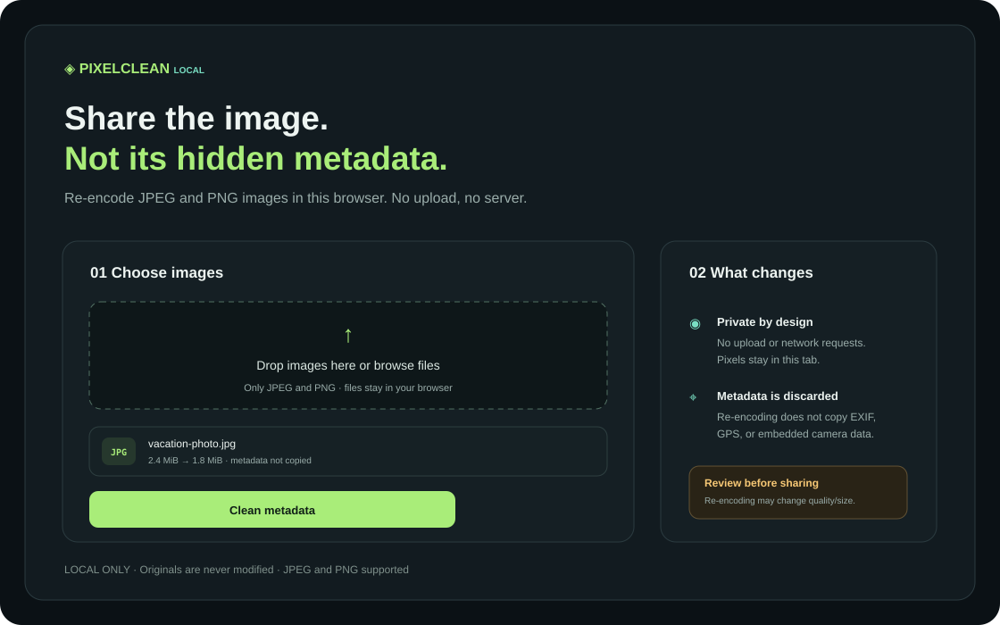

# PixelClean Local

**Create a shareable JPEG or PNG copy without carrying embedded camera metadata.** PixelClean Local re-encodes image pixels in your browser; your source files are not changed or uploaded.

[](https://github.com/GhosTnever-lkm/pixelclean-local/actions/workflows/ci.yml) [](https://github.com/GhosTnever-lkm/pixelclean-local/releases) [](LICENSE)



## What it does

- Re-encodes JPEG and PNG files through the browser canvas, so source EXIF/GPS/camera metadata is not copied to the new output.
- Works locally in the open tab. The project has no upload endpoint, analytics, external JavaScript, or account requirement.
- Keeps the original unchanged and creates a separately named download.
- Processes at most 20 images per batch, limits each input to 20 MiB, and rejects decoded images above 40 megapixels before allocating the drawing canvas.
- Supports keeping the source format or converting to PNG/JPEG; JPEG output quality is adjustable.

It is a best-effort metadata removal workflow, not a forensic certification tool. Re-encoding can change image quality and file size. APNG files are detected and rejected so the app cannot silently export only one frame. Other animated formats, WebP, GIF, HEIC, and metadata inspection are not supported; review the output before sharing.

## Use it

Open the [live app](https://ghostnever-lkm.github.io/pixelclean-local/), choose JPEG/PNG images with the keyboard or mouse, select an output format, and click **Clean metadata**. Download each cleaned copy individually. Before starting another batch, download any ready copies and clear the queue. No command-line tools or installation are required.

Run locally by opening `index.html`, or serve the folder:

```bash
python -m http.server 4173
```

Then visit `http://localhost:4173`. Modern browser support for `createImageBitmap`, Canvas `toBlob`, and JPEG/PNG decoding is required.

## Development

Requires Node.js 20 or later. The app has no runtime dependencies.

```bash
npm test
npm run check
```

Download a versioned archive from [Releases](https://github.com/GhosTnever-lkm/pixelclean-local/releases/latest).

## ☕ Support / Pro Version

The core app is free under MIT. No paid edition is currently offered. For custom privacy-first browser tools, open a [GitHub issue](https://github.com/GhosTnever-lkm/pixelclean-local/issues) or use [GitHub Sponsors](https://github.com/sponsors/GhosTnever-lkm).
